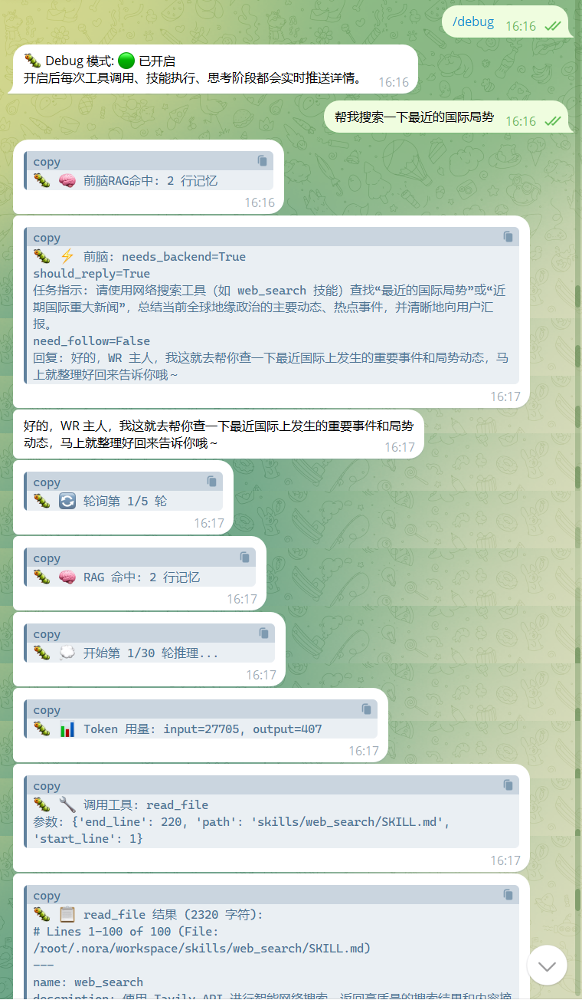

# NORA 使用指南（实战版）

> 面向 N.O.R.A.Core 的日常使用者与运维者：教你如何更高效、顺畅地与 Nora 协作和相伴。

---

# P1 面向大部分日常使用者

## 1. 常用指令表

你可以直接复制以下内容发给 Telegram 的 `@BotFather` 用于配置自动补全菜单：

```text
status - 查看状态报告
context - 查看当前上下文
undo - 撤销上一条回复
override - 撤回并重新回复
stop - 停止当前任务
end_segment - 结束当前消息段
clear - 清空聊天记录
set_stream - 切换输出模式
model - 查看/切换模型
effort - 设置推理强度
custom_scope - CUSTOM 注入范围
nora_prefs - Nora 偏好设置
schedule_today - 查看今日主动消息计划
regenerate_proactive - 重建主动消息计划
rtc - 语音/视频通话
debug - 调试用 切换调试
debug_cleanup - 调试用 清理选项
```

> [!WARNING]
> **关于 `/start` 指令**：旧版中伪装成普通打招呼的 `/start` 指令已被彻底移除。这是为了防止无意中清空数月积累的宝贵对话记忆。若确需清空历史记录，请使用有明确二次确认的 `/clear`。

---

## 2. 核心交互机制：前后脑协同与真人化聊天

Nora 采用前后脑分离架构：
- **前脑（Front Brain）**：负责日常拟人化对话、情感共鸣、即时回复，以及审查后脑提交的工作结果。
- **后脑（Back Brain）**：负责工具调用、深度推理、技能编写执行与外部数据检索。

这意味着：
- **边聊边干**：你交给 Nora 一个复杂的编码或信息搜集任务时，后脑会接手执行；同时前脑依然可以继续陪你聊天、回答日常问题。
- **随时打断与插话**：在后脑忙碌执行过程中，你可以随时对她说“停下”、“改一下需求”或“这个不用查了”，Nora 会立即捕获打断意图并调整行为。
- **一次性发多条消息**：你不需要像对待传统机器人那样“问一句等一句”，你可以连续发多条消息、发图片、发文字，Nora 的消息聚合器会智能整合并自然回复。


---

## 3. 记忆与养成：把她当作真正的助手

Nora 会在工作区维护多个 Markdown 记忆与身份文件（详见 [身份与记忆文件一览](architecture/identity_files.md)）：
- `SOUL.md`：Nora 的核心人设、口吻、个性与底线原则。
- `USER.md`：关于你的个人档案（称呼、职业、爱好、饮食偏好、特殊习惯等）。
- `SCHEDULE.md`：作息习惯与日程安排。
- `APPEARANCE.md`：Nora 维护的自身形象与穿着外貌设定，配合参考图用于自主自拍或拍照发图。

**养成小建议**：
在日常对话中，直接告诉她你的习惯、作息和喜好，例如：*“我晚上通常 12 点后睡觉，早上 8 点半起床，不要太早找我”*、*“我平时喜欢喝无糖乌龙茶”*。Nora 会自主提炼这些信息并写入档案，后续的对话与主动问候都会自然融合这些认知。

---

## 4. 选择合适且稳定的模型体系

Nora 的各组件高度依赖不同能力维度的模型，请优先选择稳定、可靠的 API 节点。

### 核心必备模型：
1. **`smart` 模型（前脑主模型）**：
   - 职责：日常聊天、情绪价值、拟人回复与审查转述。
   - 建议：选用 Roleplay 优秀、情商高、语言流畅自然且不易出戏的模型（如 `gemini-3-flash-preview`、`claude-3-5-sonnet` 等）。
2. **`coder` 模型（后脑执行主模型）**：
   - 职责：复杂任务分解、编写代码、调用工具与外部技能。
   - 建议：选用代码与工具调用（Function Calling）强悍、遵循指令严密的模型（如 `gpt-5.1-codex-max`、`claude-3-7-sonnet` 等）。
3. **`fast` 模型（快速决策）**：
   - 职责：低延迟路由、判断是否需要追问、邮件与消息初步过滤。
   - 建议：选用高响应速度、极低成本的轻量模型（如 `gemini-2.5-flash-lite`）。
4. **`image` 模型（图像理解）**：
   - 职责：对收到的图片提取关键词标签、描述画面与 OCR 文本。
   - 建议：选用高水准的多模态视觉模型（如 `gemini-3.1-pro-preview` 等）。
5. **`summary` 模型（记忆总结）**：
   - 职责：段落摘要压缩、槽位沉淀与长远滚动归档。
   - 建议：选用长文本提炼能力强、总结客观精准的中轻量模型（如 `grok-4.1` 或 Flash 系列）。

### 扩展专用模型：
- **`video`**：视频理解模型（支持长视频画面理解与帧分析）。
- **`draw` & `draw_desc`**：生图模型与生图提示词转换模型（用于配合 `APPEARANCE.md` 出图）。
- **`security`**：高风险工具调用前的安全审计模型。

---

## 5. 在线状态、消息段与追问机制

Nora 的记忆压缩基于“消息段（Conversation Segment）”：
- **完全在线（ONLINE）**：你在和 Nora 频繁互动时，处于完全在线状态。
- **拟人追问**：若你聊到一半突然不说话，Nora 会根据对话上下文判断是否追问或关心（例如发问号或询问你怎么了）。
- **告别与半在线（SEMI_ONLINE）**：若你仍未回复，Nora 会向你告别并切入半在线状态。此时这一轮对话封闭为一个完整消息段，后台自动触发分段摘要和压缩。
- **主动结束消息段**：如果你想明确告诉 Nora“这次对话到此结束，去休息吧”，可以直接跟她说拜拜，或输入 `/end_segment` 指令强制封闭并生成摘要。

---

## 6. 图片与多模态回顾

- **自动建档**：你发送给 Nora 的每一张照片，都会在后台自动提取关键词标签、OCR 文字与画面描述，并与向量数据库绑定。
- **像真人一样回顾**：经过一段时间后，你可以自然地对她说：*“我上周发给你的那张蓝天的照片还在吗？”* 或 *“帮我找找之前拍的那张发票”*。Nora 会自主调用 `view_media` 工具把历史照片检索出来并结合当前问题继续讨论。
- **动图与表情包**：Nora 会自动提取视频表情包首帧与静态缩略图接入视觉分析链，能够看懂你发送的梗图和表情包。

---

## 7. 实时语音与视频通话（RTC）

在 Telegram 客户端中，你可以直接和 Nora 随时进行实时音视频通话：
- **发起通话**：输入 `/rtc` 指令，或在机器人个人菜单中点击 **Call Nora** 按钮打开 Mini App 通话界面。
- **双向语音交互**：Nora 会带着她的性格人设和长期记忆接通，能听懂你的实时语音并以自然语音回应。
- **随时打断**：在她说话时你可以随时开口打断，对话流转极为自然。
- **摄像头视觉输入**：通话期间可随时短时间开启摄像头，向她展示你眼前的物体、正在阅读的书本或身处的环境，Nora 能够实时看到并和你探讨。
- **通话记忆沉淀**：通话挂断后，系统会自动聚合整通对话记录并生成通话总结，无缝写入日常记忆库中。

---

## 8. 实用控制指令

- `/undo`：撤销上一轮 AI 的回复，并将上下文恢复到上一轮状态（当你对刚才的回答不满意时非常有用）。
- `/override`：撤销上一条回复并立即重新生成。
- `/effort`：为当前或指定模型别名配置推理强度（`low` / `medium` / `high`），适合在深度思考与响应速度之间平衡。
- `/set_stream`：切换回复是否使用流式输出（持久化配置）。
- `/nora_prefs`：交互式调整 Nora 的偏好设置（如主动消息概率、追问敏感度等）。

---

# P2 面向专业与深度使用者

## 1. 善用 Debug 模式

- 输入 `/debug` 指令可开关调试模式。开启后，Nora 的前后脑思考过程、工具调用细节、审查转述原始信息等都会以系统消息直接呈现，便于观察决策链路。
- 输入 `/debug_cleanup` 可调出调试清理选项。



## 2. 定期审查与校正 Markdown 记忆文件

Nora 的个性与长期认知沉淀在工作区根目录的 Markdown 文件中：
- 建议定期查看 `USER.md`，检查是否有记录偏差或过时信息，可直接在文本中编辑修正。
- 形象文件 `APPEARANCE.md` 可由你与 Nora 共同完善，添加或微调外貌描述、着装细节与参考图。

## 3. 安全性与环境隔离

- **沙箱建议**：在服务器部署或开放高权限工具时，强烈建议将 Nora 运行在 Docker 容器或受限子账户中。
- **模型智商与安全性正相关**：对于后脑 `coder` 和安全审查模型，绝对不要为了省钱选用参数量极小或逻辑薄弱的不可靠模型，以免在工具调用时造成非预期风险。
